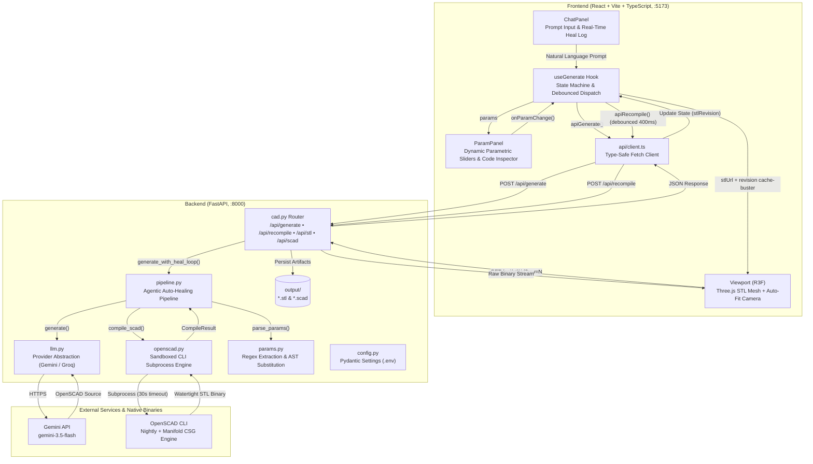
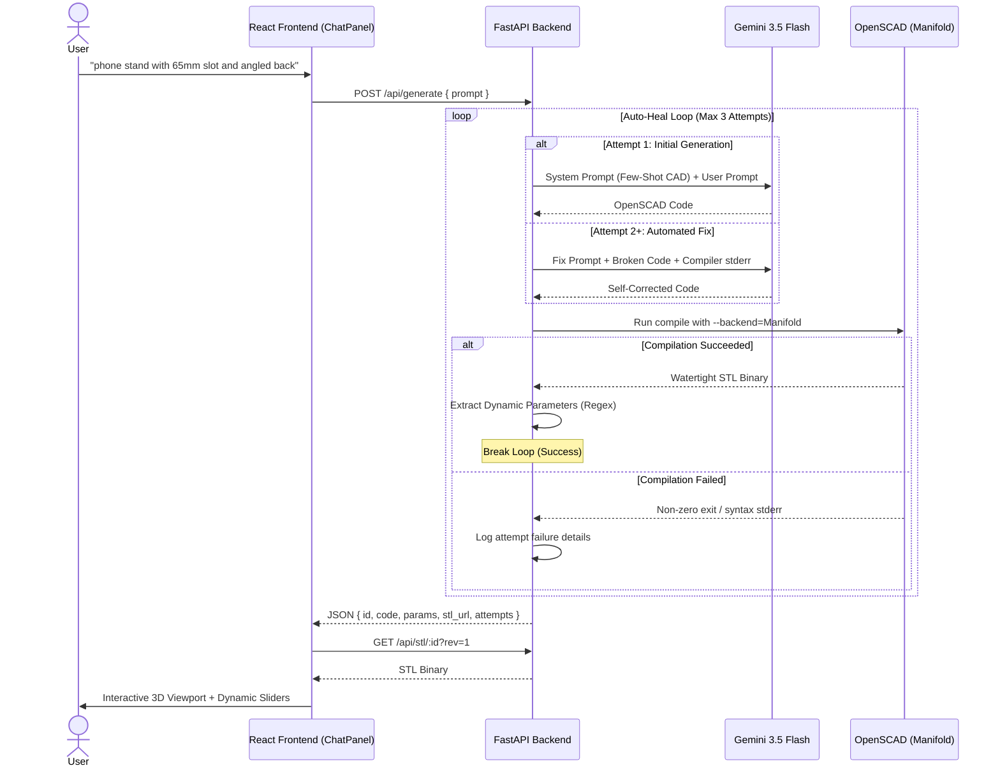
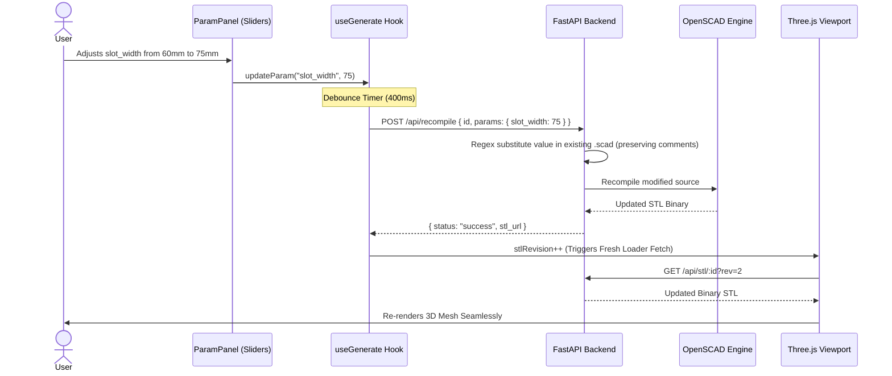

# PolyCAD AI 🧊

> **Text-to-Parametric 3D CAD with an Agentic Auto-Healing Compiler Loop & Real-time Parametric Editing.**

[](https://fastapi.tiangolo.com)
[](https://react.dev/)
[](https://threejs.org/)
[](https://openscad.org/)
[](https://tailwindcss.com/)
[](https://www.typescriptlang.org/)

---

## 🌟 Overview

Most generative 3D tools rely on non-deterministic diffusion models that output noisy point clouds or non-watertight meshes. **PolyCAD AI** takes a fundamentally different engineering approach:

1. **Deterministic Domain-Constrained Generation**: The LLM (*Gemini 3.5 Flash / Groq LLaMA 3.3*) outputs clean, declarative **OpenSCAD code**, not raw polygons.
2. **Agentic Auto-Healing Compiler Loop**: If compilation fails, compiler stderr is fed back to the model with an automated fix prompt (up to 3 retries), self-correcting syntax or geometry errors.
3. **Dynamic Parametric Sliders (Zero-LLM Recompilation)**: Top-level dimensions are extracted via regex and mapped into dynamic UI sliders. Changing dimensions re-compiles the binary mesh in milliseconds on the backend **without any additional LLM API calls**.
4. **Interactive 3D WebGL Viewport**: Renders watertight STL models in real time with OrbitControls, bounding-box auto-fit, and direct download for STL and SCAD formats.

---

## 🏗️ System Architecture



---

## 🔄 Core Workflows

### 1. Generation & Agentic Auto-Healing Loop


### 2. Instant Parametric Editing (Zero LLM Overhead)


---

## ✨ Key Features

- **Domain-Specific Few-Shot Prompting**: Enforces strict OpenSCAD practices, `$fn` facet limits (default 64), Customizer-compatible range comments (`// [min:max]`), and modular geometry.
- **Fast Geometry Engine**: Utilizes OpenSCAD's **Manifold** backend, achieving sub-10ms Boolean operations compared to legacy CGAL.
- **Multi-Attempt Self-Healing**: Automatically parses OpenSCAD compiler diagnostics and feeds line errors back into the model to heal broken CAD syntax.
- **Parametric Extraction**: Dynamic extraction of numeric parameters and Customizer comment ranges without needing full AST grammars.
- **Interactive Three.js Studio**:
  - Orbit, pan, zoom, and auto-centering on loaded bounds.
  - Collapsible code inspector.
  - Direct STL and SCAD export.
  - Real-time compiler attempt logs.
- **Security & Sandboxing**:
  - Rejection of malicious directives (`include`, `use`, `import`).
  - Isolated temporary directory execution per compilation.
  - Strict subprocess timeout limits (30s) to prevent infinite CSG recursion.

---

## 📂 Project Structure

```
PolyCAD-AI/
├── .env.example              # Environment variables template
├── .gitignore                # Git ignore rules (secrets, venvs, builds, artifacts)
├── README.md                 # Project documentation
│
├── backend/                  # Python FastAPI Backend
│   ├── requirements.txt      # Python dependencies
│   ├── app/
│   │   ├── main.py           # FastAPI entrypoint & CORS middleware
│   │   ├── config.py         # Pydantic Settings & configuration
│   │   ├── prompts/
│   │   │   └── __init__.py   # System prompts, few-shot examples & fix templates
│   │   ├── routers/
│   │   │   └── cad.py        # REST API endpoints (/generate, /recompile, /stl, /scad)
│   │   └── services/
│   │       ├── llm.py        # LLM Provider abstraction (Gemini / Groq)
│   │       ├── openscad.py   # CLI subprocess wrapper & validation sandbox
│   │       ├── params.py     # Regex parameter parser & in-place substitutor
│   │       └── pipeline.py   # Self-healing compilation pipeline
│   └── output/               # Generated STL & SCAD cache (.gitkeep tracked)
│
└── frontend/                 # React + Vite + TypeScript Frontend
    ├── package.json          # Node dependencies
    ├── vite.config.ts        # Vite configuration (React + Tailwind v4)
    ├── tsconfig.json         # TypeScript compiler configuration
    └── src/
        ├── App.tsx           # Main application layout
        ├── types.ts          # Shared TypeScript interfaces
        ├── index.css         # Tailwind CSS entrypoint
        ├── api/
        │   └── client.ts     # Type-safe API client wrappers
        ├── hooks/
        │   └── useGenerate.ts# State machine hook & debounced recompilation
        └── components/
            ├── ChatPanel.tsx # Prompt input, submission & heal log display
            ├── ParamPanel.tsx# Dynamic range sliders & code viewer
            └── Viewport.tsx  # Three.js / React Three Fiber STL viewer
```

---

## 🚀 Getting Started

### Prerequisites

- **Python** 3.10+
- **Node.js** 18+ & npm
- **OpenSCAD** (Nightly recommended for Manifold CSG engine) — [Download OpenSCAD](https://openscad.org/downloads.html#snapshots)
- **API Key**: Google Gemini API Key or Groq API Key

---

### 1. Clone & Configure

```bash
git clone https://github.com/Visk4/PolyCAD-AI.git
cd PolyCAD-AI
```

Create a `.env` file in the `backend/` folder:

```bash
cp .env.example backend/.env
```

Edit `backend/.env` with your system paths and API credentials:

```ini
# OpenSCAD binary path (use openscad.com on Windows)
OPENSCAD_PATH="D:/OpenSCAD (Nightly)/openscad.com"

# LLM Configuration
LLM_PROVIDER=gemini
LLM_MODEL=gemini-3.5-flash
GEMINI_API_KEY=your_actual_gemini_api_key_here

# Alternative: Groq
# LLM_PROVIDER=groq
# LLM_MODEL=llama-3.3-70b-versatile
# GROQ_API_KEY=your_groq_api_key_here
```

---

### 2. Backend Setup

```bash
cd backend
python -m venv .venv

# Windows (PowerShell)
.venv\Scripts\activate

# macOS / Linux
source .venv/bin/activate

pip install -r requirements.txt
python -m uvicorn app.main:app --reload --port 8000
```

Verify backend health at: `http://localhost:8000/health`

---

### 3. Frontend Setup

In a new terminal:

```bash
cd frontend
npm install
npm run dev
```

Open your browser at **`http://localhost:5173`**.

---

## 📡 API Reference

| Method | Endpoint | Description | Request Body | Response |
| :--- | :--- | :--- | :--- | :--- |
| `POST` | `/api/generate` | Generates CAD code via LLM, auto-heals errors, and compiles STL. | `{ "prompt": string }` | `{ id, status, code, params, stl_url, scad_url, attempts }` |
| `POST` | `/api/recompile` | Re-compiles existing CAD model with updated numeric parameters. | `{ "id": string, "params": { [name]: number } }` | `{ status, code, stl_url, error }` |
| `GET` | `/api/stl/{id}` | Serves the generated binary STL file. | *None* | `application/octet-stream` |
| `GET` | `/api/scad/{id}`| Serves the generated OpenSCAD source file. | *None* | `text/plain` |
| `GET` | `/health` | Service health check and OpenSCAD engine configuration. | *None* | `{ status, openscad_path }` |

---

## 🧪 Sample Prompts for Testing

- **Desk Phone Stand**: `phone stand with 65mm slot and angled back support`
- **Parametric Hex Organizer**: `hex pencil holder with 7 slots arranged in a honeycomb pattern`
- **Mechanical Gear**: `spur gear with 16 teeth, 30mm pitch radius and a center mounting hole`
- **Cable Clip**: `desk cable organizer with 4 rounded channels and screw holes`
- **Stackable Box**: `stackable storage box with interlocking rim and finger slots`

---

## 🛡️ Security Considerations

- **Directive Blacklisting**: Code containing `include <...>`, `use <...>`, or `import(...)` is rejected immediately to prevent arbitrary local filesystem reads.
- **Subprocess Isolation**: Every compilation runs in a freshly created temporary directory (`tempfile.mkdtemp()`) and cleans up after execution.
- **Process Deadlock Prevention**: Subprocess calls are enforced with a strict 30-second execution timeout.

---

## 📜 License

This project is licensed under the MIT License.
